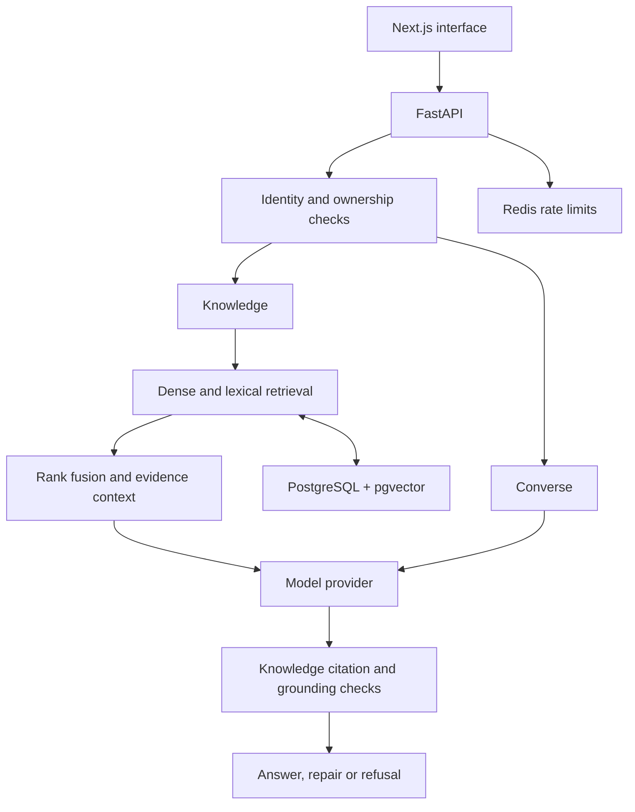

# Aqlyra RAG AI

**A full-stack AI application for private-document Q&A and general conversation.**

Aqlyra combines document ingestion, hybrid retrieval, citation checks and user-scoped storage in a Next.js + FastAPI application. Knowledge mode answers from selected documents; Converse supports open-ended chat, history and turn-specific attachments.

[Hosted application](https://aqlyra-ai.vercel.app) · [Architecture](docs/ARCHITECTURE.md) · [Setup](docs/SETUP.md) · [Documentation](docs/README.md)

## Engineering highlights

| Problem | Implementation | Explore the code |
|---|---|---|
| Relevant passages can use different wording or exact keywords | Dense retrieval and PostgreSQL full-text search, combined with Reciprocal Rank Fusion | [Rank fusion](backend/app/retrieval/rank_fusion.py) |
| Generated answers may cite missing or unsupported evidence | Bounded evidence context, citation validation, grounding checks, repair and refusal paths | [RAG components](backend/app/rag) |
| Private documents must stay within account boundaries | Ownership checks for documents, conversations, memory and retrieval scopes | [Isolation tests](backend/tests/test_security_isolation_matrix.py) |
| Authentication needs more than a login form | Email verification, Google ID-token validation and HttpOnly session cookies | [Security design](docs/SECURITY_TESTING.md) |
| A working model call is only one part of a service | Docker deployment, Redis rate limits, readiness checks, structured logs and CI | [Workflows](.github/workflows) |

## Product experience

- **Knowledge:** ingest documents, select a document scope, ask questions and inspect cited sources.
- **Converse:** stream general chat responses with history, memory and attachments.
- **Optional integrations:** image understanding and LiveKit voice require configured providers and services.
- **Scripted walkthrough:** the frontend's `/demo` route illustrates the experience without backend access. Its examples are labelled and do not execute real model inference.

**Release context:** this README describes the checked-in source. The hosted application uses separate release branches, so it may differ from `main`. See [release context and limitations](docs/PROJECT_STATUS.md) before evaluating live features.

## Architecture



Document parsers and OCR feed chunking and embedding stages before retrieval. Provider adapters separate model services from application logic. [Detailed architecture](docs/ARCHITECTURE.md) · [RAG pipeline](docs/RAG_PIPELINE.md)

## Stack

| Layer | Technologies |
|---|---|
| Interface | Next.js 16, React 19, TypeScript |
| API and data | FastAPI, Pydantic, SQLAlchemy, Alembic |
| Retrieval | PostgreSQL, pgvector, full-text search, RRF |
| AI integrations | Hugging Face embeddings, Groq / OpenAI-compatible adapters |
| Operations | Redis, Docker Compose, Caddy, GitHub Actions |
| Testing | pytest, FastAPI TestClient, Node test runner |

## Run locally

With Git, Python 3 and Docker Desktop / Compose v2 available on macOS:

```bash
git clone https://github.com/naim-munshi/aqlyra-rag-ai.git
cd aqlyra-rag-ai
bash scripts/ops/mac_local_up.sh
```

Open [the local app](http://127.0.0.1:3000/login) and [Mailpit](http://127.0.0.1:8025) to complete test email verification.

The local stack runs real authentication and persistence with **deterministic AI defaults**. Configure model providers for genuine inference. It is bound to localhost; see the [local guide](docs/MAC_LOCAL_SOFTWARE.md) or [manual setup](docs/SETUP.md) for configuration.

## Validation and limitations

Tests cover retrieval, citations, grounding, authentication, ownership isolation, provider failures and operational configuration. [GitHub Actions](https://github.com/naim-munshi/aqlyra-rag-ai/actions) records results per branch and commit.

The [retrieval baseline](backend/evaluation/BASELINE.md) uses 10 synthetic documents and 20 labelled queries with deterministic embeddings. It validates retrieval plumbing and ranking; it is **not a production semantic-quality benchmark**. Query rewriting and LLM reranking are optional and disabled by default on this baseline.

Real-provider quality, live multi-user acceptance, load behaviour and independent backup restoration need their own evidence. Passing unit tests does not establish those results.

## Explore the repository

| Directory | Purpose |
|---|---|
| [backend/app](backend/app) | API, ingestion, retrieval, generation and persistence |
| [backend/tests](backend/tests) | Backend regression and integration tests |
| [backend/evaluation](backend/evaluation) | Controlled retrieval experiments |
| [frontend/src](frontend/src) | Interface, session handling and API proxy |
| [scripts/ops](scripts/ops) | Startup, health, backup and restore tools |
| [docs](docs/README.md) | Engineering guides and deployment procedures |

For a short technical review, start with rank fusion, citation validation and the isolation tests linked above. Use [Setup](docs/SETUP.md) for test commands and [Staging](docs/STAGING.md) for release checks.

## Author and license

Built by [Md Naim](https://github.com/naim-munshi). See [LICENSE](LICENSE) for usage terms.
